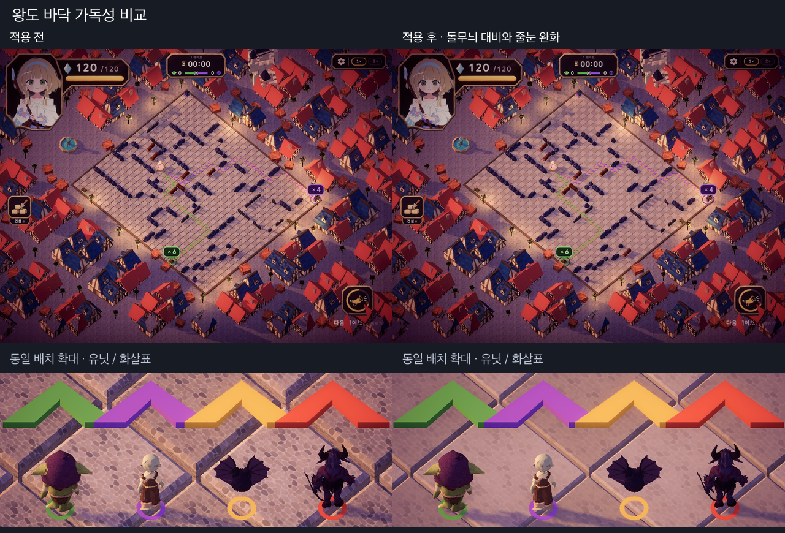

# 왕도 가독성 1차 — 바닥 패턴과 줄눈

2026-11-19. 요청: “왕도도 한번 적용해서 비교 올려줘”.

왕도 활성 스테이지 프리팹의 전투 바닥에만 적용했다. 돌무늬가 유닛 실루엣과 경쟁하는 정도를 줄이기 위한 첫 비교이며 최종 아트 수치 확정은 아니다.

| 항목 | 이전 | 적용 |
| --- | --- | --- |
| 바닥 텍스처 | Ground_Cobble | Ground_Cobble_Board |
| 선형 RGB 평균으로부터의 텍스처 편차 | 100% | 35% |
| tileGap | 0.05 | 0.025 |
| tileBevel | 0.04 | 0.018 |

원본 1024×1024 텍스처의 평균 선형 RGB와 알파를 보존하는 별도 파생 텍스처를 생성했다. 주변 장식과 기존 테스트 씬이 사용하는 원본은 HEAD와 동일함을 확인했다. 조명, 후처리, 팩션 색상, 기본 카메라는 그대로다. 공용 타일 생성 코드에서 타일 크기로 경로 화살표 폭을 계산하므로 간격 축소에 따라 화살표 폭도 소폭 넓어진다. 모서리 폭 설정은 스폰 패드에도 사용된다.

## 비교 결과

같은 구도의 실제 Unity 렌더에서 잔돌의 밝고 어두운 무늬와 두꺼운 줄눈이 약해졌다. 바닥의 석재 질감을 남기면서 화살표와 유닛 윤곽 주변의 시각적 혼잡이 줄었다. 전체 화면에서 격자는 여전히 식별된다.

왕도 기본 줌은 27.4167, 보드는 35×30으로 그대로다. 원거리에서 유닛이 작은 문제와 박쥐·악마의 어두운 몸체 디테일은 이번 바닥 조정으로 해결되지 않는다.

## 검증과 재현

- Unity 6000.3.28f1 CLI로 임시 복제 프로젝트에서 적용 전·후 Play Mode 실행, 왕도 선택 및 1280×960 캡처 각 5장 완료. 두 실행 모두 `CAPITAL_FLOOR_CAPTURE_PASS` 도달.
- 준비 화면, 고정 틱 600회(시뮬레이션 10초) 후 전투 화면, 바닥만, 일반 바닥의 통제 배치, 경로 재질의 통제 배치를 촬영했다. 두 실행의 10초 시점 유닛 수는 각각 10이다.
- 전투 캡처는 게임의 일반 Update를 멈추고 직접 틱을 진행하므로 HUD 시계는 00:00일 수 있다. 10초는 실제 대기 시간이 아닌 600틱 기준이다.
- 확대 비교는 카메라 줌 1.8에서 같은 좌표에 유닛 4종과 실제 경로 화살표 메시·재질을 별도 배치한 통제 시험이다. 자연 교전 장면이 아니다. 경로 재질 시험은 보드 전체를 해당 재질로 바꾼 시험이다.
- 카메라 각도·기본 및 확대 줌·배치 좌표의 전후 일치, 런타임에 새 텍스처와 간격·모서리 값이 로드된 것을 확인했다.
- C# 컴파일 오류는 로그에서 발견되지 않았다. 두 실행에서 UnityEditor.Search.SearchDatabase 시작 예외가 있었으나 이후 캡처는 완료됐다. 종료 시 Persistent 할당 경고도 있어 에디터 로그가 완전히 깨끗하다고 판단하지 않는다.
- 전투 코드 변경은 없으며 EditMode 전투 테스트와 Windows 빌드, 전체 웨이브 플레이는 이번에 실행하지 않았다.

증거·캡처 스크립트·텍스처 생성기: [evidence](../ai-use/evidence/20261119-capital-floor/README.md).
