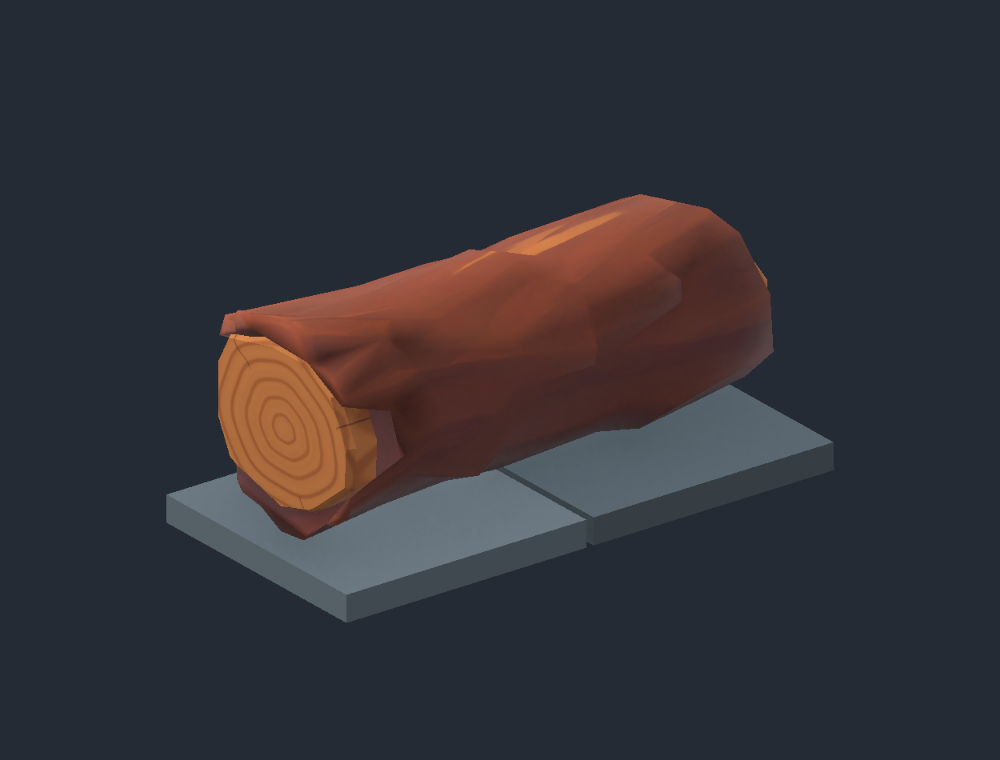

# 통나무 — 2×1칸 프리팹

사용자 제공 `Meshy_AI_Cartoon_Log_20261118_texture_fbx.zip`을 Blender 5.3.0에서 수정하고 Unity 6000.3.28f1에 임포트했다. 부풀어 있던 한쪽 목재 단면을 얕은 모서리 면이 있는 절단면으로 다시 만들고, 해당 단면의 나이테 텍스처와 껍질 끝을 정리했다. 몸통·반대쪽 단면의 원본 UV와 색상 텍스처는 유지했다.

## 사용

- 프리팹: `ProjectBeViolenceDefense/Assets/03_Prefabs/04_World/CartoonLog/CartoonLog_2x1.prefab`
- `DefenseGrid.CellPosition`의 **1칸 = 1 Unity 단위** 기준으로 가로 2칸 × 세로 1칸 크기다.
- 메시 X×Y×Z: **1.92 × 0.806442 × 0.880844**. 콜라이더: **1.92 × 0.806442 × 0.92**. 외곽 여유를 둔다.
- 피벗은 바닥 중앙, 기본 길이 방향은 X축, 루트 Scale은 `(1,1,1)`이다.
- `(x,z)`와 `(x+1,z)` 두 셀 위에 놓으려면 프리팹 위치를 `(x+0.5,0,z)`로 잡는다. 세로 배치는 Y축 90° 회전 후 두 셀 중심의 중간에 둔다.
- URP/Lit 재질 2개, 삼각형 352개, 정적 BoxCollider 1개다.

이번 적용 범위는 **모델·재질·콜라이더를 갖춘 2칸 크기의 프리팹 임포트**다. 씬에 영구 배치하거나 기존 벽을 교체하지 않았다. 현재 `DefenseGrid`의 이동·시야 차단은 콜라이더를 자동 수집하지 않으므로, 이 프리팹을 게임 규칙상의 장애물로 사용할 때에는 점유한 두 셀을 그리드 데이터에도 등록해야 한다. 기존 1칸 벽 배치 코드에 이 프리팹만 대입해서는 안 된다.

## 결과물 목록

아래 Unity 결과물과 폴더에는 Editor가 생성한 `.meta`도 함께 포함된다.

| 경로 | 도구·변경 | 사용 상태 |
| --- | --- | --- |
| `ProjectBeViolenceDefense/Assets/05_Art/05_Meshes/Environment/CartoonLog/CartoonLog_2x1.fbx` | Blender MCP: 단면 재구성, 껍질 끝 조정, 크기·피벗 정규화, FBX 내보내기 | Unity 임포트·프리팹 참조 |
| `ProjectBeViolenceDefense/Assets/05_Art/06_Textures/CartoonLog/CartoonLog_BaseColor.png` | Codex 파일 복사: 제공된 원본 텍스처 | 몸통·반대쪽 단면에 사용 |
| `ProjectBeViolenceDefense/Assets/05_Art/06_Textures/CartoonLog/CartoonLog_EndGrain.png` | Blender Python/NumPy: 512px 나이테·작은 균열 텍스처 생성 | 수정 단면에 사용 |
| `ProjectBeViolenceDefense/Assets/05_Art/02_Materials/CartoonLog/CartoonLog_Bark.mat` | Unity CLI/Editor API: URP/Lit 재질 생성·FBX remap | 프리팹 사용 |
| `ProjectBeViolenceDefense/Assets/05_Art/02_Materials/CartoonLog/CartoonLog_EndGrain.mat` | Unity CLI/Editor API: URP/Lit 재질 생성·FBX remap | 프리팹 사용 |
| `ProjectBeViolenceDefense/Assets/03_Prefabs/04_World/CartoonLog/CartoonLog_2x1.prefab` | Unity CLI/Editor API: 모델·BoxCollider 연결, 단위 스케일 | 배치 가능한 임포트 결과물 |
| `Art3D/CartoonLog/CartoonLog_Repaired.blend` | Blender MCP: 원본 비교 모델·수정 모델·2칸 미리보기 씬, 텍스처 packed | 로컬 편집 원본. 기존 gitignore로 제외 |
| `Art3D/CartoonLog/repair_log.py`, `export_log.py`, `import_unity.cs`, `preview_unity.cs`, `verify_unity.cs` | Codex: 수정·내보내기·임포트·검증 작업 스크립트 | 로컬 재현 자료. 게임 코드 아님 |
| `Art3D/CartoonLog/*.png`, `*.json`, `CartoonLog_2x1.fbx`, `Source/` | Blender·Unity CLI: 원본 추출, 중간 렌더, 최종 복사본·검증 보고 | 로컬 작업 자료. 기존 gitignore로 제외 |
| `ai-use/evidence/20261118-cartoon-log/` | Codex: 최종 Unity 미리보기·검증 JSON 복사 | 저장소에서 공유할 검증 증거 |

## 확인

- Blender: 비매니폴드 에지 0, 열린 경계 에지 0, 면적 0인 면 0. 원본처럼 껍질과 목재 단면은 각각 닫힌 구성 요소다.
- Unity: FBX 임포트 후 실측 치수·바닥 피벗·재질 2개·텍스처 참조 확인. PreviewRenderUtility로 URP 렌더 확인.
- Play Mode: 프레임 진행 확인(420→429). 프리팹 인스턴스를 생성하여 두 셀 중심의 Collider.Raycast 적중, 인접 셀 비적중, Y축 90° 회전 후 1×2 범위 확인. 테스트 인스턴스 제거 후 Play Mode 종료.
- Play Mode 확인 후 Console error/warning 0, compilationFailed=false. 소스 코드와 기존 씬 에셋은 변경하지 않았다. Windows 실행 파일 빌드는 수행하지 않았다.

