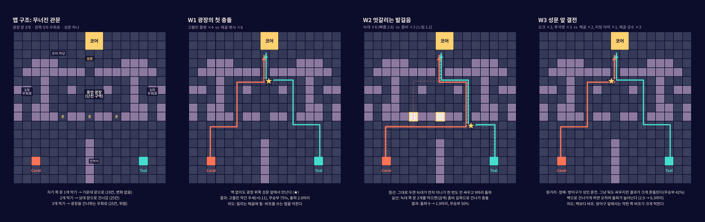

# 1스테이지 레벨: 무너진 관문

> 첫 레벨 디자인 시안이다. 지형은 `GameScene` → `Voxel Defense Prototype` → `Board Layout`, 웨이브는 같은 컴포넌트의 `Rounds`에서 바꾼다. 수치 검증은 `BalanceSim`으로 한다.



## 지형

17줄 × 17칸이다. 첫 줄이 코어 쪽(y=16)이고 `#`이 고정 벽, `C`가 코어다. Coral 스폰은 (2, 2), Teal 스폰은 (14, 2)다.

```
........CC.......   16  코어
........CC.......   15
.................   14  코어 마당
..###.......###..   13  마당 엄폐물
.#######.#######.   12  성문(가운데), 우회로 출구(양 끝)
...#.........#...   11
##.#..#...#..#.##   10  광장 기둥, 우회로 꺾임
...#.........#...    9
#.##.........##.#    8  우회로 꺾임
#.###.##.##.###.#    7  광장 문 3개, 우회로 입구(양 끝)
.................    6
.................    5
........#........    4  스폰 칸막이
........#........    3
........#........    2
........#........    1
........#........    0
```

| 구역 | 모양 | 의도 |
| --- | --- | --- |
| 스폰 구역 | 가운데 칸막이로 좌우 분리 | 출발하자마자 섞이지 않고 정해진 곳에서 만난다 |
| 광장 문 3개 | 왼쪽 (5, 7), 가운데 (8, 7), 오른쪽 (11, 7) | 막은 문의 개수로 경로를 고르는 장치 |
| 중앙 광장 | 9 × 4칸, 기둥 2개 | 기본 교전 장소. 기둥이 시야를 끊어 작은 싸움으로 나눈다 |
| S자 우회로 | 양 가장자리의 꺾인 통로 | 광장을 건너뛰는 위험한 길. 문을 너무 많이 막은 대가 |
| 성문·코어 마당 | 한 칸짜리 성문과 엄폐물 | 마지막 길목 |

### 문을 막을 때의 경로

| 막은 문 | 해당 진영의 경로 | 길이 |
| --- | --- | --- |
| 없음 | 자기 쪽 문 → 광장 → 성문 | 19칸 |
| 자기 쪽 문 1개 | 가운데 문으로 돌아감 | 19칸 (변화 없음) |
| 2개 | 상대 진영의 문으로 건너가 상대 길목에서 만남 | 25칸 |
| 3개 모두 | S자 우회로로 광장을 건너뜀 | 25칸 |

## 웨이브

| 웨이브 | Coral | Teal | 배우는 것 |
| --- | --- | --- | --- |
| W1 광장의 첫 충돌 | 고블린 졸병 4 | 해골 병사 6 | 저절로 만나는 교전에서 밀리는 쪽에 힐·버프를 쓴다 |
| W2 엇갈리는 발걸음 | 늑대 6 (속도 2.6) | 좀비 3 (속도 1.2) | 속도가 다르면 만나지 않는다. 벽으로 경로 길이를 바꿔 만나게 한다 |
| W3 성문 앞 결전 | 오크 2, 투석병 3 | 해골 병사 2, 리빙 아머 1, 해골 궁수 3 | 벽이 늘 답은 아니다. 방어구 앞에서는 약한 쪽 버프가 크게 먹힌다 |

진영 안에서는 위에 적은 순서대로 나온다. W3에서 느린 리빙 아머를 맨 앞에 두면 뒤 유닛이 막혀 교전이 거의 일어나지 않으므로 가운데에 둔다. W3 다음에는 W1부터 반복한다.

## 검증 결과

`BalanceSim rounds`로 씬의 지형·편성과 카탈로그 수치를 그대로 읽어, 마법 없이 웨이브마다 프레임 시간 변화 12종을 돌렸다. 평균 차는 (Coral 남은 체력 비율 − Teal 남은 체력 비율)이고 ±0.2 안이면 무승부로 센다.

| 웨이브 | 플레이어 벽 | Coral 승 | Teal 승 | 무승부 | 평균 차 | 코어 돌파 (C + T) |
| --- | --- | --- | --- | --- | --- | --- |
| W1 | 없음 | 25% | 0% | 75% | +0.11 | 1.2 + 0.8 |
| W2 | 없음 | - | - | - | - | 6.0 + 3.0 (교전 없음) |
| W2 | (5, 7), (8, 7) | 17% | 33% | 50% | -0.08 | 0.5 + 1.4 |
| W3 | 없음 | 50% | 8% | 42% | +0.09 | 2.3 + 0.6 |
| W3 | (5, 7), (8, 7) | 0% | 0% | 100% | +0.15 | 4.3 + 2.0 |

- W2는 벽이 없으면 늑대가 좀비보다 먼저 지나가 한 번도 싸우지 않는다. 늑대 쪽 문 2개를 막으면 늑대가 좀비 쪽 문으로 건너가 좀비 길목에서 부딪치고, 돌파가 9마리에서 1.9마리로 준다.
- W3에서 W2와 같은 벽을 쓰면 교전 위치가 엇갈려 돌파가 2.9마리에서 6.3마리로 늘어난다.
- 마법은 검증하지 않았다. 각 웨이브에서 마법이 결과를 얼마나 바꾸는지는 Play Mode에서 확인한다.

## 재현

```bash
cd BalanceSim
SEEDS=12 WALLS="" dotnet run -c Release -- rounds          # 벽 없음
SEEDS=12 WALLS="5,7;8,7" dotnet run -c Release -- rounds   # 플레이어 벽 지정
```
