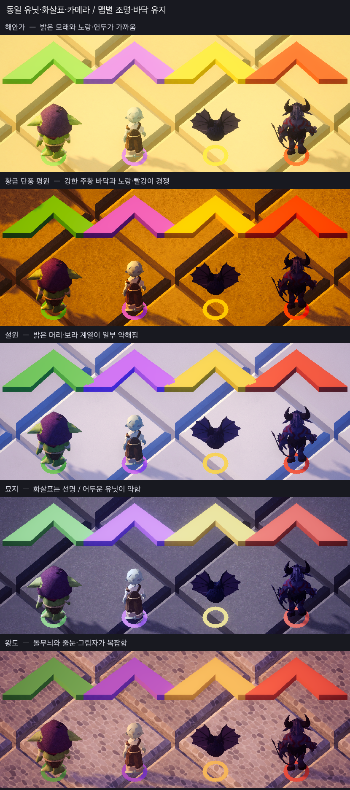

# 맵별 가독성 비교 — 2026-11-19

현재 연결된 5개 스테이지를 실제 Unity에서 촬영했다. 게임 설정 수정 없이 비교만 수행했다.

| 맵 | 확인된 문제 | 우선 조정 후보 |
| --- | --- | --- |
| 해안가 | 밝은 노란 바닥과 노랑 화살표·진영 링의 구분이 약하다. 밝은 머리와 연두도 대비가 줄어든다. | 보드 바닥의 노랑 채도·최대 밝기를 낮추고 노랑 표식의 외곽 대비 보강 |
| 황금 단풍 평원 | 바닥·장식·조명이 강한 주황 계열로 모인다. 노랑·빨강 화살표가 바닥과 경쟁하고 격자·그림자가 강하다. | 전투 보드의 주황 채도·질감·줄눈 대비 완화. 강한 단풍색은 주변 장식에서 유지 |
| 설원 | 상대적으로 실루엣 구분이 좋다. 밝은 머리는 바닥에 가까워지고 보라 화살표가 푸른 줄눈·그림자와 겹치면 약해진다. | 눈의 흰 밝기와 파란 줄눈/그림자 대비를 소폭 완화 |
| 묘지 | 밝은 화살표는 잘 보인다. 어두운 박쥐·악마의 몸 안쪽 디테일은 어두운 보라 바닥과 합쳐진다. | 바닥 전체를 더 어둡게 하기보다 유닛의 밝기·실루엣 분리를 보강 |
| 왕도 | 돌무늬의 잔잔한 명암 변화, 큰 격자선과 그림자가 겹쳐 유닛에 시선이 덜 모인다. 기본 줌에서 유닛이 가장 작다. | 바닥 돌무늬 대비와 줄눈을 먼저 완화하고 기본 카메라 범위를 별도로 검토 |

## 공통으로 확인한 점

- 문제는 타일 A/B 색 차이 하나로 설명되지 않는다. 반복 질감, 어두운 타일 경계, 장식의 그림자, 맵별 조명·후처리가 함께 보인다. 영향의 크기를 분리한 인과 실험은 아직 수행하지 않았다.
- 동일한 진영색 화살표도 해안에서는 밝은 연두, 단풍에서는 진한 초록, 묘지에서는 민트에 가깝게 렌더된다. 화살표 역시 맵별 조명·후처리의 영향을 받는다. 바닥색 조정과 함께 표식 색의 일관성을 점검해야 한다.
- 모든 맵을 한 번에 어둡게 만드는 방식은 묘지의 어두운 유닛 문제를 악화시킬 수 있다. 맵 분위기는 유지하되 전투 보드의 채도·질감·줄눈 대비를 먼저 제한하는 방향이 적합해 보인다.

| 맵 | 보드 크기 | 기본 직교 크기 |
| --- | --- | --- |
| 해안가 | 17×17 | 13.32 |
| 황금 단풍 평원 | 19×18 | 14.88 |
| 설원 | 19×20 | 15.67 |
| 묘지 | 23×23 | 18.02 |
| 왕도 | 35×30 | 27.42 |

왕도 기본 카메라의 직교 크기는 해안의 약 2.06배다. 같은 출력 해상도에서 같은 크기 유닛은 약 49% 높이로 보인다. 따라서 왕도의 문제는 색 대비뿐 아니라 표시 크기도 포함한다. 통제 확대 컷은 모든 맵을 직교 크기 1.8로 맞춰 이 차이를 제외했다.

[기본 준비·전투 전체 화면](../ai-use/evidence/20261119-map-readability/overviews.png) · [기본/경로 타일 비교](../ai-use/evidence/20261119-map-readability/route-comparison.png) · [촬영 조건·한계·원본](../ai-use/evidence/20261119-map-readability/README.md)

위 조정 후보는 캡처에 근거한 제안이다. 아직 실제 색상·조명·카메라 설정은 바꾸지 않았다.
