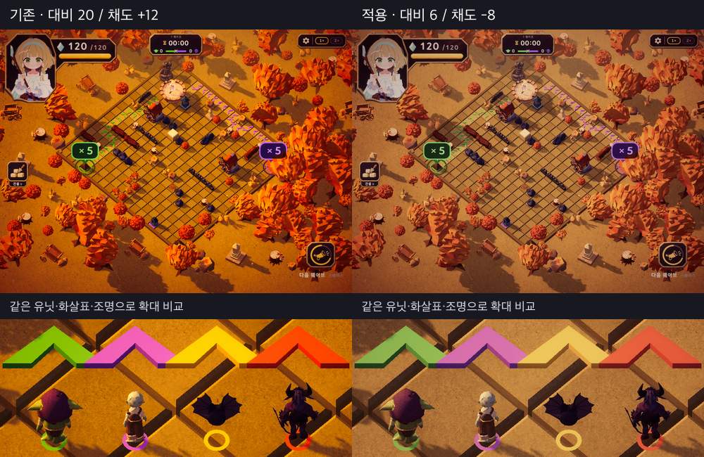

# 단풍 가독성 1차 조정

`Stage_GoldenMaple_Volume.asset`의 Color Adjustments만 수정했다.

| 값 | 기존 | 적용 |
| --- | --- | --- |
| Contrast | 20 | 6 |
| Saturation | +12 | -8 |

주황색 단풍 분위기를 유지하면서 전체 화면의 과한 채도·명암 자극을 줄이는 첫 조정안이다. 바닥뿐 아니라 화살표·유닛·주변 장식에도 적용된다. 조명, 노출, 화이트밸런스, 블룸, 타일 색/질감, 카메라 줌은 이번 단계에서 수정하지 않았다.

같은 장면에서 후처리 값만 바꿔 기본 준비/전투 화면과 확대 비교 컷을 촬영했다. 강한 주황색과 극단적인 명암이 줄어드는 것을 확인했다. 검은 유닛의 내부 디테일, 바닥 질감과 격자선 문제는 남아 있어, 이것을 해결한 최종안으로 보지는 않는다.

Unity 6000.3.28f1 Play Mode 촬영과 저장 에셋 재임포트 검증을 통과했다. 프로필 GUID와 단풍 프리팹 참조를 보존했다. [원본 및 검증 방법](../ai-use/evidence/20261119-maple-grade/README.md).
